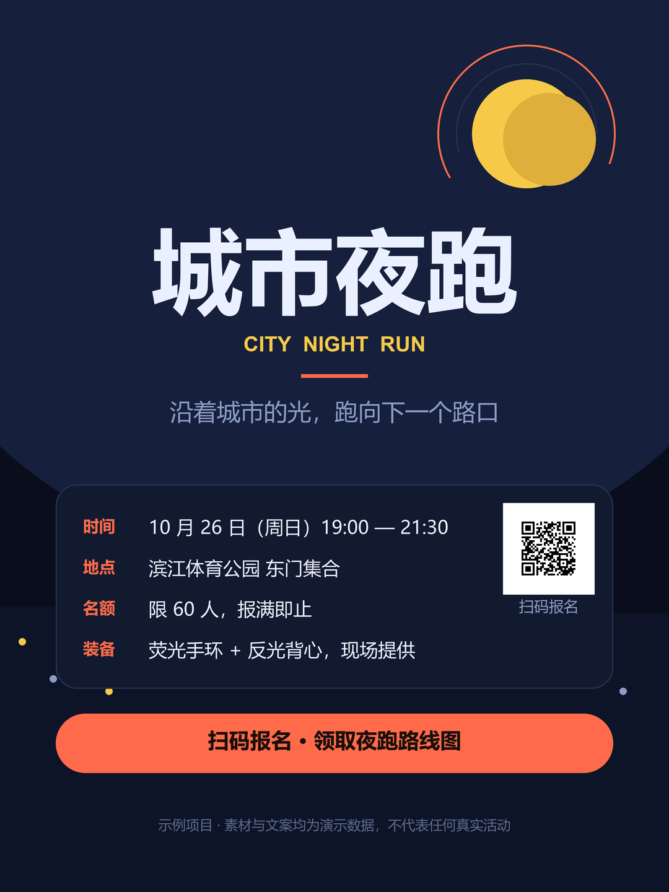

<div align="center">

# Poster Master

**把一句需求、一堆客户素材，变成可直接交付的海报。**

[English](README_EN.md) · [快速开始](docs/getting-started.md) · [安装](docs/installation.md) · [文档索引](docs/README.md)

[](LICENSE)
[](skills/poster-master/SKILL.md)
[](.claude-plugin/marketplace.json)
[](skills/poster-master/agents/openai.yaml)

</div>



> 上图由本技能包自带的无头渲染器直接产出：1080 × 1440 px，47 个组件，二维码可解码。
> 素材与文案均为演示数据，示例工程在 <code>skills/poster-master/examples/城市夜跑/</code>。

---

## 这是什么

Poster Master 是一个 **Agent 技能包**，不是又一个海报模板集合。

它接管的是「做一张海报」这件事的**全过程**：把需求拆成信息层级，定出视觉方向，产出可读的第一稿，
迭代并记录反馈，最后交付 PNG / SVG / 分层 PSD，并附带一个**可继续编辑的组件源稿**。

它的四条硬规则，是从大量返工里长出来的：

1. **文案事实不能猜。** 日期、价格、地点、报名链接未经确认，就只能标记为待确认，不能填一个"看起来合理"的值。
2. **二维码永远不重绘。** 解码原码 → 与客户确认的链接逐字符比对 → 重新生成干净码 → 真机实测。
3. **印刷和社交是两个文件。** 同一张图不静默复用，尺寸、出血、色彩模式按载体分别出。
4. **交付靠检查，不靠眼睛。** <code>check_delivery.py</code> 核对尺寸、色彩模式、文件完整性和二维码可解码性。

## 快速开始

### Claude Code（插件市场）

<code>/plugin marketplace add Ilovegood123isgad/Poster_master</code>

<code>/plugin install poster-master@poster-master</code>

### Codex / 任意 Agent（下载即用）

1. 下载 [poster-master-skill-1.0.0.zip](dist/poster-master-skill-1.0.0.zip)（约 320 KB）。
2. 解压后把 <code>poster-master</code> 整个目录放进你的技能目录：
   <code>~/.codex/skills/</code>、<code>~/.claude/skills/</code>，或任何 Agent 约定的 skills 目录。
3. 确认根目录下的 <code>SKILL.md</code> 存在且可读——这是所有 Agent 的入口。

也可以直接克隆：

```bash
git clone https://github.com/Ilovegood123isgad/Poster_master.git
mv Poster_master/skills/poster-master ~/.codex/skills/
```

### 第一次调用

```text
$poster-master 帮我做一张骑行社团招新海报，尺寸 A3，落地页链接是 https://example.com/join
```

Agent 会读 <code>SKILL.md</code> → 选路由 → 问真正影响设计的那几个问题 → 产出。
详情见 [快速开始](docs/getting-started.md)。

## 它能产出什么

| 产出 | 说明 |
|---|---|
| 需求简报与文案层级表 | 每条文案带优先级标签，未确认事实单列 |
| 创意方向说明 | 3–5 个视觉关键词、配色、字体、主视觉、参考来源 |
| 组件源稿 | <code>*.poster.json</code>，图层分组、元素可改，可再次打开继续编辑 |
| PNG / SVG | 数字渠道成品，SVG 内嵌位图可继续在矢量软件里改 |
| 分层 PSD | 每个分组一个图层，交给美工继续精修 |
| 交付检查报告 | 尺寸、色彩模式、文件完整性、二维码可解码性 |
| 过程记录 | 六阶段文档 + 反馈记录 + 素材台账，随项目归档 |

## 六阶段流程

| 阶段 | 冻结的产出 | 出门前的检查 |
|---|---|---|
| 1 目标 | 受众、主要效果、核心信息、成功标准 | 简报已确认；主要效果只有一个 |
| 2 信息 | 带优先级标签的文案集、待确认问题清单 | 每个 P0 事实已确认或明确挂起 |
| 3 方向 | 视觉关键词、配色、字体、主视觉、参考 | 方向适配真实载体与受众 |
| 4 初稿 | 至少一张可读构图，意图写进文件 | 实际尺寸下可读，层级经得起远看 |
| 5 迭代 | 带决策的版本化反馈记录 | 事实复核过，遗留问题关闭或列入交付 |
| 6 交付 | 各渠道 PNG / SVG / PSD + 交付检查 | 检查通过；没有一项是"假定已验证" |

## 四条路由

Agent 按 <code>workflows/routing.md</code> 判定，只走一条，不并行：

| 路由 | 什么时候用 |
|---|---|
| 新建海报 | 从需求或素材开始（可走 Quick 档，跳过确认往返） |
| 修改海报 | 已有成品或源稿，改内容、配色、尺寸 |
| 编辑器精修 | 在组件编辑器里逐个元素调整 |
| 导出交付 | 适配渠道、出多版本、跑交付检查 |

## 内置编辑器

<code>scripts/editor/</code> 是一个 **零依赖本地编辑器**：只用 Node 标准库，不需要
`npm install`，不联网，绑定 127.0.0.1。

```bash
node "<技能目录>/scripts/editor/server.js" --project "<项目目录>" --port 41735
```

打开 <code>http://127.0.0.1:41735/</code> 即可在画布上改元素、改文案、替换素材，
并导出 PNG / SVG / 分层 PSD。说明见 [编辑器文档](docs/editor.md)。

## 脚本

| 脚本 | 作用 | 依赖 |
|---|---|---|
| <code>scripts/new_project.js</code> | 按阶段模板生成项目骨架 | Node 18+ |
| <code>scripts/editor/server.js</code> | 本地组件编辑器 | Node 18+ |
| <code>scripts/render_preview.py</code> | 无头渲染源稿为 PNG | Pillow |
| <code>scripts/check_delivery.py</code> | 交付检查（尺寸/色彩/二维码） | Pillow、OpenCV |
| <code>scripts/export_psd.py</code> | 写出分层 PSD | Pillow |
| <code>scripts/qr_extract.py</code> | 二维码检测、裁切、比对、重新生成 | OpenCV、numpy、Pillow |
| <code>scripts/cutout.py</code> | 抠图与边缘质量报告 | rembg（可选）、Pillow |

安装：<code>pip install -r skills/poster-master/requirements.txt</code>
（编辑器与脚手架不需要装任何东西。）

## 技能包结构

```text
skills/poster-master/
├─ SKILL.md              入口：强制加载顺序、路由表、交付红线
├─ agents/openai.yaml    Codex / 客户端 UI 元数据
├─ workflows/            四条路由 + 路由判定
├─ references/           12 篇按需加载的专业参考
├─ templates/            需求简报、文案层级、方向说明、交付检查表……
├─ scripts/              脚手架、渲染、检查、PSD、二维码、抠图、编辑器
├─ examples/城市夜跑/    脱敏示例工程（源稿 + 素材 + 成品）
├─ requirements.txt      Python 脚本依赖
└─ LICENSE
```

## 下载

| 方式 | 地址 |
|---|---|
| 技能包压缩包 | [dist/poster-master-skill-1.0.0.zip](dist/poster-master-skill-1.0.0.zip) |
| 源码 | <code>git clone https://github.com/Ilovegood123isgad/Poster_master.git</code> |
| Claude Code 插件 | <code>/plugin marketplace add Ilovegood123isgad/Poster_master</code> |
| 仓库首页 | <https://github.com/Ilovegood123isgad/Poster_master> |

## 环境要求

- **Node.js 18+**：编辑器与项目脚手架。
- **Python 3.9+**：Python 脚本（<code>pip install -r skills/poster-master/requirements.txt</code>）。
- **可选 rembg**：<code>cutout.py</code> 抠图，首次运行会下载分割模型。
- 磁盘上的技能目录需要可读；写交付物时需要可写。编辑器只监听本机回环地址。

## 文档

| 文档 | 内容 |
|---|---|
| [docs/getting-started.md](docs/getting-started.md) | 从一句话到一张海报的完整走法 |
| [docs/installation.md](docs/installation.md) | 三种安装方式、依赖、常见问题 |
| [docs/workflow.md](docs/workflow.md) | 六阶段与四条路由详解 |
| [docs/editor.md](docs/editor.md) | 编辑器、源稿格式、元素类型 |
| [docs/faq.md](docs/faq.md) | 常见问题 |
| [docs/why-poster-master.md](docs/why-poster-master.md) | 设计取舍与边界 |
| [docs/en/](docs/en/README.md) | English documentation |

## 贡献

读 [CONTRIBUTING.md](CONTRIBUTING.md)。仓库里的工作约定见 [AGENTS.md](AGENTS.md)。

## 许可

MIT，见 [LICENSE](LICENSE)。技能包内不包含任何客户素材、第三方字体或模型权重。

## 致谢

技能包的仓库形态（插件市场清单、README / 文档结构、落地页、下载方式）参考了
[hugohe3/ppt-master](https://github.com/hugohe3/ppt-master) 的公开结构。
