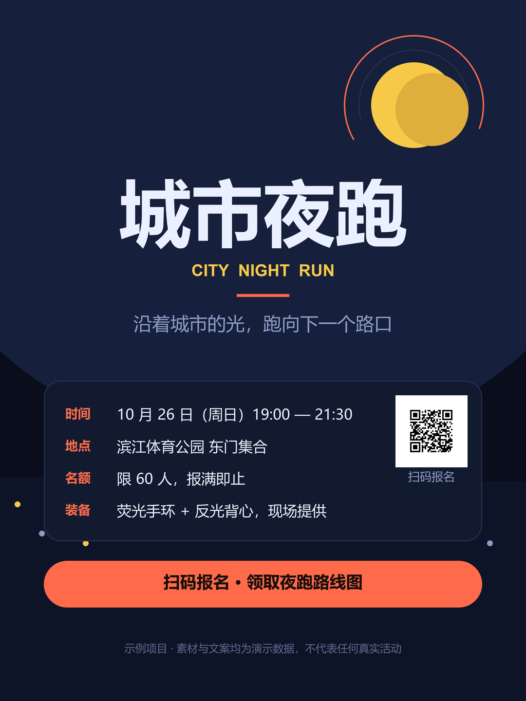

<div align="center">

# Poster Master

**From one sentence and a pile of client material to a poster that is ready to ship.**

[中文](README.md) · [Getting started](docs/en/getting-started.md) · [Installation](docs/en/installation.md) · [Docs](docs/en/README.md)

[](LICENSE)
[](skills/poster-master/SKILL.md)
[](.claude-plugin/marketplace.json)

</div>



> Rendered by the headless renderer that ships with this skill: 1080 × 1440 px, 47 components,
> QR code decodes. All copy and assets are demo data. The sample project lives in
> <code>skills/poster-master/examples/城市夜跑/</code>.

---

## What it is

Poster Master is an **agent skill package**, not another pile of poster templates.

It owns the whole job: it turns a brief into a copy hierarchy, picks a visual direction, produces a
readable first draft, iterates with a written record, and delivers PNG / SVG / layered PSD together
with an **editable component source**.

Four rules carry most of the weight, and each one exists because it was learned from rework:

1. **Facts are never guessed.** A date, price, venue or sign-up link that was not confirmed stays
   marked as unconfirmed — it never gets a plausible-looking filler value.
2. **QR codes are never redrawn.** Decode the original, compare it character by character with the
   link the client stated, regenerate a clean code, test it on a real phone.
3. **Print and social are different files.** One artwork is never silently reused across channels.
4. **Delivery is checked, not eyeballed.** <code>check_delivery.py</code> verifies dimensions,
   colour mode, file integrity, and QR readability.

## Quick start

### Claude Code (marketplace)

<code>/plugin marketplace add Ilovegood123isgad/Poster_master</code>

<code>/plugin install poster-master@poster-master</code>

### Codex / any agent (download and use)

1. Download [poster-master-skill-v1.0.0.zip](dist/poster-master-skill-v1.0.0.zip) (about 320 KB).
2. Unzip it and drop the whole <code>poster-master</code> folder into your skills directory:
   <code>~/.codex/skills/</code>, <code>~/.claude/skills/</code>, or whatever your agent expects.
3. Check that <code>SKILL.md</code> is present at the root — that file is the entry point for every agent.

Or clone it:

```bash
git clone https://github.com/Ilovegood123isgad/Poster_master.git
mv Poster_master/skills/poster-master ~/.codex/skills/
```

### First call

```text
$poster-master Make a recruitment poster for the cycling club. A3 print, sign-up link https://example.com/join
```

The agent reads <code>SKILL.md</code>, picks one route, asks the few questions that actually change
the design, and produces the poster. See [Getting started](docs/en/getting-started.md).

## What it produces

| Deliverable | What it is |
|---|---|
| Brief and copy sheet | Every line of copy tagged with priority; unconfirmed facts listed separately |
| Creative direction | 3–5 visual keywords, palette, type, key visual, references |
| Component source | <code>*.poster.json</code> — grouped layers, editable elements, reopenable later |
| PNG / SVG | Digital deliverables; the SVG embeds bitmaps and stays editable |
| Layered PSD | One layer per group, ready for a designer to refine |
| Delivery report | Dimensions, colour mode, file integrity, QR readability |
| Process record | Six stage documents, feedback log, asset ledger — archived with the project |

## The six stages

| Stage | Frozen output | Gate |
|---|---|---|
| 1 Goal | Audience, primary effect, core message, success criteria | Brief accepted; one primary effect, not three |
| 2 Information | Priority-tagged copy set, open-questions list | Every P0 fact confirmed or explicitly parked |
| 3 Direction | Keywords, palette, type, key visual, references | The direction fits the real carrier and audience |
| 4 First draft | At least one readable composition, intent recorded | Readable at actual size; hierarchy survives distance |
| 5 Iteration | Versioned feedback log with decisions | Facts re-verified; open questions closed or listed |
| 6 Output | Channel-specific PNG / SVG / PSD plus a delivery check | The checklist passes; nothing is assumed verified |

## Four routes

The agent selects exactly one route from <code>workflows/routing.md</code>:

| Route | When |
|---|---|
| New poster | Starting from a brief or raw material (Quick profile skips the confirmation round trip) |
| Revise | Changing copy, colour, or size of an existing poster or source |
| Editor refine | Adjusting element by element in the component editor |
| Deliver | Adapting to channels, producing versions, running the delivery check |

## The built-in editor

<code>scripts/editor/</code> is a **dependency-free local editor**: Node standard library only, no
`npm install`, no network, bound to 127.0.0.1.

```bash
node "<skill dir>/scripts/editor/server.js" --project "<project dir>" --port 41735
```

Open <code>http://127.0.0.1:41735/</code> to edit elements and copy on a canvas, replace assets,
and export PNG / SVG / layered PSD. See the [editor documentation](docs/en/editor.md).

## Scripts

| Script | Purpose | Needs |
|---|---|---|
| <code>scripts/new_project.js</code> | Scaffold a project from the stage templates | Node 18+ |
| <code>scripts/editor/server.js</code> | The local component editor | Node 18+ |
| <code>scripts/render_preview.py</code> | Render a source headlessly to PNG | Pillow |
| <code>scripts/check_delivery.py</code> | Delivery checks (size / colour / QR) | Pillow, OpenCV |
| <code>scripts/export_psd.py</code> | Write a layered PSD | Pillow |
| <code>scripts/qr_extract.py</code> | Detect, crop, compare and regenerate QR codes | OpenCV, numpy, Pillow |
| <code>scripts/cutout.py</code> | Background removal with an edge report | rembg (optional), Pillow |

Install: <code>pip install -r skills/poster-master/requirements.txt</code>. The editor and the
scaffolder need nothing installed.

## Package layout

```text
skills/poster-master/
├─ SKILL.md              entry point: load order, routing table, delivery red lines
├─ agents/openai.yaml    Codex / client UI metadata
├─ workflows/            four routes plus the routing authority
├─ references/           12 focused reference documents
├─ templates/            brief, copy sheet, direction, delivery checklist, …
├─ scripts/              scaffold, render, check, PSD, QR, cutout, editor
├─ examples/城市夜跑/    sanitised sample project (source + assets + output)
├─ requirements.txt      Python script dependencies
└─ LICENSE
```

## Download

| Way | Link |
|---|---|
| Skill archive | [dist/poster-master-skill-v1.0.0.zip](dist/poster-master-skill-v1.0.0.zip) |
| Source | <code>git clone https://github.com/Ilovegood123isgad/Poster_master.git</code> |
| Claude Code plugin | <code>/plugin marketplace add Ilovegood123isgad/Poster_master</code> |
| Repository | <https://github.com/Ilovegood123isgad/Poster_master> |

## Requirements

- **Node.js 18+** — editor and project scaffolder.
- **Python 3.9+** — Python scripts (<code>pip install -r skills/poster-master/requirements.txt</code>).
- **Optional rembg** — <code>cutout.py</code>; it downloads a segmentation model on first use.
- The skill directory must be readable; deliverable directories must be writable. The editor listens
  on the loopback interface only.

## Documentation

| Document | Covers |
|---|---|
| [docs/en/getting-started.md](docs/en/getting-started.md) | One sentence to one poster, end to end |
| [docs/en/installation.md](docs/en/installation.md) | Install paths, dependencies, troubleshooting |
| [docs/en/workflow.md](docs/en/workflow.md) | The six stages and the four routes in detail |
| [docs/en/editor.md](docs/en/editor.md) | Editor, source format, element types |
| [docs/en/faq.md](docs/en/faq.md) | Common questions |
| [docs/en/why-poster-master.md](docs/en/why-poster-master.md) | Design decisions and boundaries |

## Contributing

Read [CONTRIBUTING.md](CONTRIBUTING.md). Repository working rules live in [AGENTS.md](AGENTS.md).

## License

MIT — see [LICENSE](LICENSE). The package contains no client material, third-party fonts, or model
weights.

## Credits

The repository shape (marketplace manifest, README / docs layout, landing page, download flow)
follows the public structure of [hugohe3/ppt-master](https://github.com/hugohe3/ppt-master).
